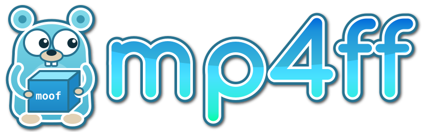

[](https://github.com/Eyevinn/mp4ff/actions/workflows/go.yml)
[](https://coveralls.io/github/Eyevinn/mp4ff?branch=master)
[](https://pkg.go.dev/github.com/Eyevinn/mp4ff)
[](https://github.com/avelino/awesome-go#video)
[](https://github.com/Eyevinn/mp4ff/blob/master/LICENSE)
[](https://app.osaas.io/browse/eyevinn-mp4ff?create=1&utm_source=github&utm_medium=readme&utm_campaign=mp4ff)

Module mp4ff is a Go library and a set of command line tools for parsing and writing MP4 (ISOBMFF) files.
It is focused on fragmented files as used for streaming in MPEG-DASH, HLS fMP4, CMAF and MSS, but can also
decode and encode progressive MP4 and QuickTime files.

Beyond the file format, it handles the codec-specific boxes of

* video: AVC, HEVC (including MV-HEVC and Dolby Vision), VVC, AV1, VP8, VP9, AVS3, Motion JPEG and ProRes
* audio: AAC (including HE-AAC and xHE-AAC), AC-3, E-AC-3, AC-4, Opus, FLAC, ALAC, IAMF, MPEG-H 3D Audio,
  MP3 and PCM
* subtitles: WebVTT, TTML and 3GPP timed text
* event message tracks

and Common Encryption with the cenc and cbcs schemes.
Separate packages parse the bitstreams of several of these codecs.
See [Codec support](#codec-support) for the sample entries and boxes.

## Command line tools

The [cmd](cmd) directory has command line tools built with the library:

* [mp4ff-info](cmd/mp4ff-info) prints the box tree of an mp4 file, or checks its brands
* [mp4ff-pslister](cmd/mp4ff-pslister) prints the AVC and HEVC parameter sets and the AV1 sequence header
* [mp4ff-nallister](cmd/mp4ff-nallister) lists the NAL units and picture types of AVC, HEVC and VVC video
* [mp4ff-subslister](cmd/mp4ff-subslister) lists WebVTT and TTML subtitle samples
* [mp4ff-crop](cmd/mp4ff-crop) crops a progressive mp4 file
* [mp4ff-encrypt](cmd/mp4ff-encrypt) and [mp4ff-decrypt](cmd/mp4ff-decrypt) encrypt and decrypt
  fragmented files with Common Encryption
* [mp4ff-mvhevc](cmd/mp4ff-mvhevc) inspects and muxes MV-HEVC files
* [mp4ff-defragment](cmd/mp4ff-defragment) converts a fragmented mp4 file into a progressive one

Install them with `brew install mp4ff`, with `go install`, or from the Linux packages and archives on the
[releases page](https://github.com/Eyevinn/mp4ff/releases).
See [cmd/README.md](cmd/README.md) for more about each tool, all ways to install them,
and how to run them in [Eyevinn Open Source Cloud](https://app.osaas.io/browse/eyevinn-mp4ff?utm_source=github&utm_medium=readme&utm_campaign=mp4ff).

To look inside a file interactively, use [mp4lens](https://github.com/Eyevinn/mp4lens), a box viewer built on
mp4ff. It runs in the terminal and as a web page that decodes files in the browser, and shows the box tree with
decode errors, the fields and bytes of each box, and search.

## Codec support

The supported codecs and their boxes are

| Type | Codec | Sample Entry | Config Box | Other Boxes |
| ---- | ----- | ------------ | ---------- | ----------- |
| Video | AVC/H.264 | avc1, avc3 | avcC | btrt, pasp, colr |
| Video | HEVC/H.265 | hvc1, hev1 | hvcC | btrt, pasp, colr |
| Video | MV-HEVC, Apple spatial video | hvc1, hev1 | hvcC, lhvC | vexu, hfov, btrt, pasp, colr |
| Video | Dolby Vision | dvh1, dvhe | hvcC, dvcC, dvvC, dvwC | btrt, pasp, colr |
| Video | AV1 | av01 | av1C | btrt, pasp, colr |
| Video | AVS3 | avs3 | av3c | btrt, pasp, colr |
| Video | VP8/VP9 | vp08, vp09 | vpcC | btrt, pasp, colr, SmDm, CoLL |
| Video | VVC/H.266 | vvc1, vvi1 | vvcC | btrt, pasp, colr |
| Video | Motion JPEG | mjpg, jpeg, mp4v | jpgC, esds | btrt, pasp, colr, fiel |
| Video | Apple ProRes (QuickTime) | apch, apcn, apcs, apco, ap4h, ap4x | - | colr, fiel, pasp, clap |
| Video | Encrypted | encv | sinf | btrt |
| Audio | AAC, HE-AAC, xHE-AAC | mp4a | esds | btrt |
| Audio | AC-3 | ac-3 | dac3 | btrt |
| Audio | E-AC-3 | ec-3 | dec3 | btrt |
| Audio | AC-4 | ac-4 | dac4 | btrt |
| Audio | Opus | Opus | dOps | btrt |
| Audio | IAMF | iamf | iacb | btrt |
| Audio | FLAC | fLaC | dfLa | btrt |
| Audio | ALAC/Apple Lossless | alac | alac | wave, frma, chan, btrt |
| Audio | PCM, MP3 and older codecs (QuickTime) | lpcm, twos, sowt, in24, in32, fl32, fl64, ulaw, alaw, ima4, MAC3, MAC6, QDM2, QDMC, agsm, .mp3 | - | wave, frma, chan, btrt |
| Audio | MPEG-H 3D Audio | mha1, mha2, mhm1, mhm2 | mhaC | btrt |
| Audio | Encrypted | enca | sinf | btrt |
| Subtitles | WebVTT | wvtt | vttC, vlab | vttc, vtte, vtta, vsid, ctim, iden, sttg, payl, btrt |
| Subtitles | WebVTT paint model (experimental) | wvtc | vttC, vlab, ttma | vttn, and the wvtt boxes above |
| Subtitles | TTML | stpp | - | btrt |
| Subtitles | TTML paint model (experimental) | stpc | ttma | ttmn, ttmb, btrt |
| Subtitles | 3GPP timed text, chapters | tx3g, text | ftab | - |
| Subtitles | Text (QuickTime) | text | - | - |
| Events | Event message track | evte | silb | btrt |
| Timecode | Timecode (QuickTime) | tmcd | - | gmhd, gmin, tcmi |

Video sample entries can also carry the HDR metadata boxes `clli` and `mdcv`.
Encrypted sample entries keep the original sample entry type in the `frma` box inside `sinf`,
which also has the `schm` box and the `schi` box with `tenc`.
The `pssh`, `senc`, `saiz` and `saio` boxes are supported as well.

## Using the library

Add the module to your project with

    go get github.com/Eyevinn/mp4ff

and read, print and write a file like

```go
f, err := mp4.ReadMP4File("input.mp4")
if err != nil {
    log.Fatal(err)
}
if err := f.Info(os.Stdout, "", "", "  "); err != nil {
    log.Fatal(err)
}
if err := mp4.WriteToFile(f, "output.mp4"); err != nil {
    log.Fatal(err)
}
```

The guide to the library is the [documentation of the mp4 package](https://pkg.go.dev/github.com/Eyevinn/mp4ff/mp4).
It describes

* [the structure of `mp4.File`](https://pkg.go.dev/github.com/Eyevinn/mp4ff/mp4#hdr-Structure_and_usage)
  for progressive and fragmented files
* [how to create init and media segments](https://pkg.go.dev/github.com/Eyevinn/mp4ff/mp4#hdr-Creating_new_fragmented_files)
* [lazy decoding of `mdat`](https://pkg.go.dev/github.com/Eyevinn/mp4ff/mp4#hdr-Lazy_decoding_and_writing_of_mdat_data)
  for large files
* [sample data in other files](https://pkg.go.dev/github.com/Eyevinn/mp4ff/mp4#hdr-Sample_data_in_other_files)
  referenced by the `dref` box
* [faster I/O with `SliceReader` and `SliceWriter`](https://pkg.go.dev/github.com/Eyevinn/mp4ff/mp4#hdr-More_efficient_I_O_using_SliceReader_and_SliceWriter)
  and [writing files efficiently](https://pkg.go.dev/github.com/Eyevinn/mp4ff/mp4#hdr-Writing_files_and_segments_efficiently).
  The benchmarks are in [BENCHMARKS.md](BENCHMARKS.md).
* [encoding modes and optimizations](https://pkg.go.dev/github.com/Eyevinn/mp4ff/mp4#hdr-Encoding_modes_and_optimizations)

Sample numbers in the APIs start at 1, as in the ISOBMFF standard.

### Packages

The packages in the mp4ff module are

* [mp4](mp4) decodes (parses) and encodes (writes) a large number of MP4 boxes. It also has functions for
  extracting, encrypting and decrypting samples, and a lot more.
* [avc](avc) parses AVC (H.264) NAL unit headers, slice headers, SPS and PPS, and finds start codes
  in Annex B byte streams.
* [hevc](hevc) parses HEVC (H.265) NAL unit headers, slice headers, VPS, SPS and PPS, including MV-HEVC.
* [vvc](vvc) parses VVC (H.266) NAL unit headers and the vvcC decoder configuration record.
* [sei](sei) decodes and encodes Supplementary Enhancement Information (SEI) messages, such as timestamps,
  for AVC and HEVC video.
* [av1](av1) parses AV1 OBUs and the sequence and frame headers, extracts tile ranges and handles
  the av1C configuration record.
* [vp9](vp9) parses the VP9 uncompressed frame header (key-frame detection, color config and size).
* [vp8](vp8) parses the VP8 frame tag and key-frame header (key-frame detection and size).
* [aac](aac) decodes and encodes the AAC AudioSpecificConfig, including HE-AAC and xHE-AAC (USAC),
  and ADTS headers, which are common for AAC in MPEG-2 TS streams.
* [iamf](iamf) parses IAMF (Immersive Audio Model and Formats) OBUs and descriptors.
* [ivf](ivf) reads and writes the IVF container used for raw VP8, VP9 and AV1 bitstreams.
* [boxtree](boxtree) decodes the box tree of a file with the position of each box, and keeps going after
  errors, reporting them for the smallest box that fails.
* [bits](bits) provides bit-wise and byte-wise readers and writers used by the other packages.

### Examples

Example code for some common use cases is in the [examples](examples) directory:

* [initcreator](examples/initcreator) creates typical init segments (ftyp + moov) for different video and
  audio codecs
* [resegmenter](examples/resegmenter) reads a segmented file (CMAF track) and resegments it with other
  segment durations using `FullSample`
* [segmenter](examples/segmenter) takes a progressive mp4 file and creates init and media segments from it,
  with one or more tracks, and can read and write `mdat` in lazy mode
* [multitrack](examples/multitrack) parses a fragmented file with multiple tracks
* [combine-segs](examples/combine-segs) combines single-track init and media segments into multi-track segments
* [add-sidx](examples/add-sidx) adds a top-level sidx box describing the segments of a fragmented file
* [ivf-to-mp4](examples/ivf-to-mp4) muxes an AV1, VP9 or VP8 IVF bitstream into a fragmented mp4
  (one fragment per GOP)
* [stream-encrypt](examples/stream-encrypt) is an HTTP server that encrypts and refragments an mp4 file
  on the fly

## Contributing

Contributions are welcome. See [CONTRIBUTING.md](CONTRIBUTING.md) for how to set up the pre-commit hooks,
the commit message format and how to add a new box.

## Stability

The APIs should be fairly stable, but minor non-backwards-compatible changes may happen until version 1.

## Specifications

The main specification for the MP4 file format is the ISO Base Media File Format (ISOBMFF) standard
ISO/IEC 14496-12:2026 (8th edition). Boxes specified in other standards say so in their code comments.

## License

MIT, see [LICENSE](LICENSE).

Some code in the mp4 package comes from or is based on <https://github.com/jfbus/mp4> which has
`Copyright (c) 2015 Jean-François Bustarret`.

Some code in the bits package comes from or is based on <https://github.com/tcnksm/go-casper/tree/master/internal/bits>
`Copyright (c) 2017 Taichi Nakashima`.

The gopher in the logo is adapted from the Go gopher, created by
[Renée French](https://reneefrench.blogspot.com/) and licensed under
[CC BY 4.0](https://creativecommons.org/licenses/by/4.0/).

## ChangeLog and Versions

See [CHANGELOG.md](CHANGELOG.md).

## Support

Join our [community on Slack](http://slack.streamingtech.se) where you can post any questions regarding any of our open source projects. Eyevinn's consulting business can also offer you:

* Further development of this component
* Customization and integration of this component into your platform
* Support and maintenance agreement

Contact [sales@eyevinn.se](mailto:sales@eyevinn.se) if you are interested.

## About Eyevinn Technology

[Eyevinn Technology](https://www.eyevinntechnology.se) is an independent consultant firm specialized in video and streaming. Independent in a way that we are not commercially tied to any platform or technology vendor. As our way to innovate and push the industry forward we develop proof-of-concepts and tools. The things we learn and the code we write we share with the industry in [blogs](https://dev.to/video) and by open sourcing the code we have written.

Want to know more about Eyevinn and how it is to work here. Contact us at work@eyevinn.se!
